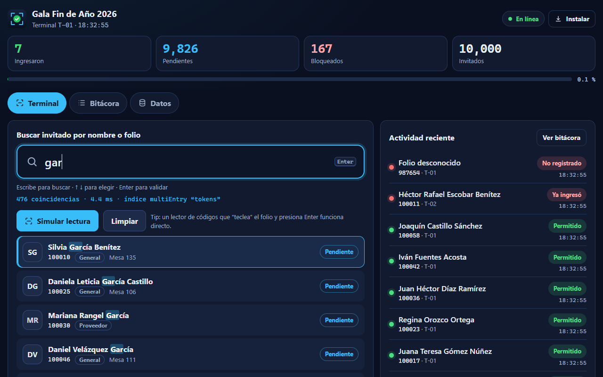
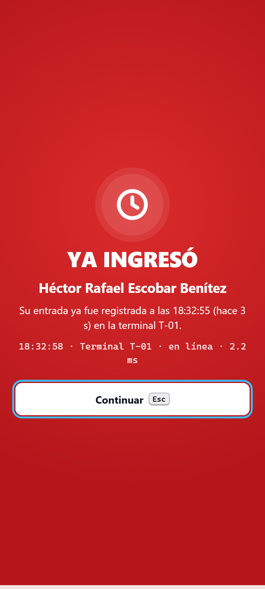

# Control de Acceso · Terminal de validación (PWA)

**Tema 6 — Control de Acceso Local / Lector de Identificadores (Simulador de Terminal).**
Panel ultrarrápido para controlar la entrada a eventos cerrados (fiesta, junta directiva o área restringida). El operador busca a un invitado por **nombre o folio** en una base de datos local precargada en **IndexedDB** y registra su entrada. La pantalla completa cambia al instante a **verde (Acceso permitido)** o **rojo (Ya ingresó / Denegado / No registrado)**. Todo funciona **sin conexión** y ningún dato sale del dispositivo.

| Búsqueda predictiva | Acceso permitido | Ya ingresó (móvil) |
|---|---|---|
|  |  |  |

---

## 1. Cómo se cumple cada requerimiento

### Retos técnicos del Tema 6

| Reto evaluado | Implementación | Dónde |
|---|---|---|
| **Búsquedas indexadas en IndexedDB con respuesta en milisegundos (as-you-type)** | Cada tecla dispara una consulta por **rango de prefijo** (`IDBKeyRange.bound(p, p + '￿')`). Si la consulta tiene dígitos se usa la **clave primaria** (`folio`); si es texto se usa el índice **multiEntry `tokens`** (cada palabra del nombre normalizada, sin acentos), así “gar”, “garcía” o “maria lop” encuentran coincidencias en cualquier parte del nombre. Nunca se recorre la tabla completa. Las respuestas viejas se descartan con un número de secuencia. La interfaz muestra el tiempo real de cada consulta y la pestaña **Datos → Rendimiento de búsqueda** mide cientos de consultas (promedio, p50, p95). | `js/db.js` → `searchGuests()` · `js/app.js` → `runSearch()` |
| **Gestión de estados complejos en la UI (verde éxito / rojo error)** | Máquina de estados en `body[data-ui]`: `loading → idle → results / empty → validating → granted / duplicate / denied / not_found`. El resultado ocupa **toda la pantalla** con color, ícono, sonido (Web Audio) y vibración. Se cierra solo (configurable), con `Esc`/`Enter`, o en cuanto el lector empieza a “teclear” el siguiente folio. Incluye **Deshacer** para errores del operador. | `js/app.js` → `validate()`, `showOverlay()` · `css/styles.css` |
| **Persistencia de estados concurrentes y marcas de tiempo sin conexión** | La validación lee al invitado, cambia su estado y escribe la bitácora en **una sola transacción `readwrite`** (`durability: 'strict'`). IndexedDB serializa las transacciones, por lo que **dos pestañas/terminales nunca pueden dar acceso dos veces al mismo folio**. Los cambios se avisan a las demás pestañas con **BroadcastChannel**. Cada registro guarda `ts`, terminal, origen y si se hizo **sin red**. | `js/db.js` → `checkIn()`, `undoCheckIn()` · `js/app.js` → `onRemoteChange()` |

### Requerimientos de arquitectura PWA

| Requerimiento | Implementación |
|---|---|
| `manifest.json` con `name`, `short_name`, `theme_color`, `background_color`, `display: "standalone"` | ✅ `manifest.json` |
| Íconos 192×192 y 512×512 compatibles con máscaras | ✅ `icons/icon-*.png` (`purpose: any`) y `icons/maskable-*.png` (`purpose: maskable`, contenido dentro de la zona segura del 80 %) |
| Service Worker: **install** cachea el App Shell | ✅ `sw.js` precarga 18 archivos (HTML, CSS, JS, íconos, manifest) |
| Service Worker: **activate** limpia cachés antiguas | ✅ Borra toda caché `acceso-shell-*` distinta de la versión actual (solo las de esta app, porque en GitHub Pages el origen se comparte) |
| Service Worker: **fetch** Cache First, Network Fallback | ✅ Sirve desde caché; si no existe, va a la red y guarda la respuesta; si no hay red y es una navegación, devuelve el `index.html` cacheado |
| Persistencia en LocalStorage o **IndexedDB** (nivel avanzado) | ✅ Todo vive en IndexedDB: invitados, bitácora y configuración |
| Servirse por HTTPS (o `localhost`) | ✅ GitHub Pages sirve con HTTPS |

---

## 2. Guía de revisión (criterios de aceptación)

Se recomienda Chrome o Edge en escritorio, o Chrome en Android.

### 1. Prueba de instalación
1. Abrir la URL desplegada. Aparece el botón **Instalar** en la barra superior (o el ícono de instalar en la barra de direcciones).
2. Instalar: la app abre en su propia ventana (`standalone`) con el ícono de la terminal.
3. En Android o en Windows, mantener presionado o hacer clic derecho sobre el ícono: aparecen los accesos directos **Validar**, **Simular** y **Bitácora**.

### 2. Prueba de auditoría Lighthouse
1. DevTools → **Lighthouse** → modo *Navigation*, dispositivo *Mobile* → **Analyze page load**.
2. Se evalúan Performance, Accessibility, Best Practices y SEO.
3. Lighthouse borra el almacenamiento antes de auditar, así que cada auditoría incluye la carga inicial de 10,000 invitados. Esa carga corre en un Web Worker para no afectar el *Total Blocking Time*.

### 3. Prueba de supervivencia offline
1. Cargar la app una vez con conexión (el Service Worker precarga el App Shell).
2. DevTools → **Network → Offline** (o modo avión) y recargar: la app abre igual. El indicador cambia a **“Sin conexión · modo local”**.
3. Escribir cualquier ruta inexistente (p. ej. `/<repositorio>/otra-ruta`): se muestra la terminal, no la página de error del navegador.

### 4. Prueba de persistencia y operación sin red
1. Sin conexión, validar varios folios (p. ej. `100010` + Enter, luego `100010` otra vez → “Ya ingresó”, y `999999` → “Folio no registrado”).
2. Cerrar el navegador por completo y volver a abrir la app, todavía sin conexión: los contadores, la actividad reciente y la **Bitácora** conservan cada entrada con su hora y la marca **“Sin red”**.
3. **Concurrencia:** abrir la app en dos ventanas, validar un folio en una y ver cómo la otra se actualiza sola. Validar el mismo folio en la segunda ventana responde **“Ya ingresó”**.

---

## 3. Uso rápido

| Acción | Cómo |
|---|---|
| Buscar | Escribir nombre, apellido o folio. Los resultados aparecen mientras se escribe. |
| Validar | Tocar o hacer clic en un invitado, o usar `↑ ↓` + `Enter`. Un folio completo + `Enter` se valida directo, igual que un **lector de códigos** que “teclea” el folio. |
| Simular lector | Botón **Simular lectura**: escribe un folio aleatorio (válido, repetido o inexistente) y lo valida. |
| Cerrar resultado | `Esc`, `Enter`, tocar la pantalla o empezar a escribir el siguiente folio. |
| Deshacer | Botón **Deshacer entrada** en la pantalla verde. |
| Enfocar buscador | Tecla `/`. |
| Exportar | **Bitácora → CSV / JSON**, o **Datos → Exportar invitados (CSV)**. |
| Configurar | **Datos → Evento y terminal**: nombre del evento, ID de terminal, tiempo de cierre, sonido y vibración. |

**Datos de demostración:** 10,000 invitados generados de forma determinista (misma semilla = mismos invitados en cualquier dispositivo), con folios del `100001` al `110000`, categorías (General, VIP, Staff, Prensa, Proveedor) y ~1.5 % de invitados bloqueados. Desde **Datos** se pueden regenerar 1,000 a 50,000.

**Importar una lista propia:** **Datos → Importar desde archivo**. CSV (separado por `,` o `;`) o JSON con las columnas:

```csv
folio,nombre,apellidos,categoria,mesa,bloqueado,motivo
200001,Ana Sofía,Ramírez Torres,VIP,3,no,
200004,Jorge,Salazar Peña,General,31,si,Invitación cancelada
```

`folio` y `nombre` son obligatorios. Se omiten las filas incompletas y los folios repetidos. Hay una plantilla descargable en la misma tarjeta.

---

## 4. Arquitectura

```
├── index.html            App Shell (estructura de la interfaz + CSP)
├── manifest.json         Web App Manifest (íconos, shortcuts, screenshots)
├── sw.js                 Service Worker (install / activate / fetch)
├── css/styles.css        Estilos (tema oscuro de alto contraste, responsive)
├── js/app.js             UI: máquina de estados, búsqueda, validación, bitácora, ajustes
├── js/db.js              Capa IndexedDB: esquema, búsqueda indexada, transacciones atómicas
├── js/seed.js            Generador determinista de invitados de demostración
├── js/seed-worker.js     Web Worker que siembra la base sin bloquear la interfaz
├── js/utils.js           Normalización de texto, formatos, CSV y descargas con Blob URLs
├── icons/                Íconos any + maskable, apple-touch-icon, shortcuts, favicon
├── screenshots/          Capturas usadas por el manifest
└── tools/generate-icons.mjs   Genera los PNG de icons/ (Node, sin dependencias)
```

### Esquema IndexedDB (`control-acceso`, versión 1)

| Almacén | Clave | Índices | Contenido |
|---|---|---|---|
| `guests` | `folio` | `tokens` (multiEntry), `nameKey`, `status` | Invitados con `status` = `pending` · `in` · `blocked`, `checkedInAt`, `checkedInBy` |
| `log` | `id` (autoIncrement) | `ts`, `folio`, `result` | Bitácora: `ts`, folio, nombre, `result` (`granted`, `duplicate`, `denied`, `not_found`, `undo`, `reset`), terminal, origen, `online` |
| `meta` | `key` | — | Configuración del evento/terminal y datos del dataset cargado |

### Flujo de validación

```
Enter / clic ──► checkIn(folio)  ── transacción readwrite [guests, log] ──────────────┐
                  │ get(folio)                                                          │
                  ├─ no existe         → not_found  (rojo)                              │
                  ├─ status=blocked    → denied     (rojo, con motivo)                  │ atómico
                  ├─ status=in         → duplicate  (rojo, “ingresó a las hh:mm:ss”)    │
                  └─ status=pending    → put(status=in, checkedInAt=now) → granted (verde)
                  log.add({ ts, folio, result, terminal, online })  ────────────────────┘
               ──► overlay a pantalla completa + sonido + vibración
               ──► BroadcastChannel → las demás pestañas refrescan contadores y resultados
```

---

## 5. Ejecutar en local

No hay dependencias ni paso de compilación. Basta un servidor estático en `localhost` (el Service Worker no funciona abriendo el archivo con `file://`):

```bash
npx serve .                 # o
python -m http.server 8080  # o la extensión "Live Server" de VS Code
```

## 6. Desplegar en GitHub Pages

1. Subir el contenido de esta carpeta a la rama `main` de un repositorio de GitHub.
2. **Settings → Pages → Build and deployment → Deploy from a branch**, rama `main`, carpeta `/ (root)`.
3. En 1–2 minutos queda en `https://<usuario>.github.io/<repositorio>/`. Todas las rutas son relativas, así que funciona dentro de la subcarpeta del repositorio.

**Publicar una nueva versión:** cambiar `VERSION` en `sw.js` (p. ej. `v1.0.1`). Los usuarios verán el aviso **“Hay una nueva versión · Actualizar”** y la caché anterior se elimina en `activate`.

**Regenerar íconos:** `node tools/generate-icons.mjs`.
